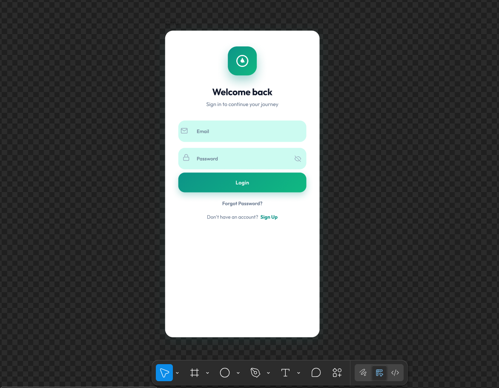
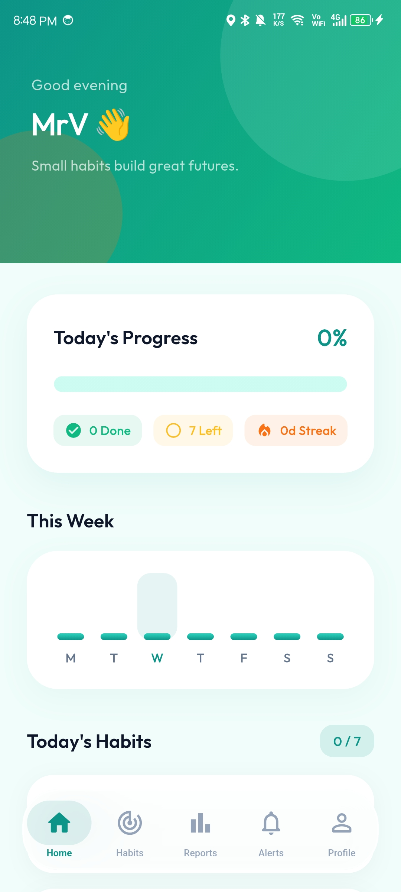
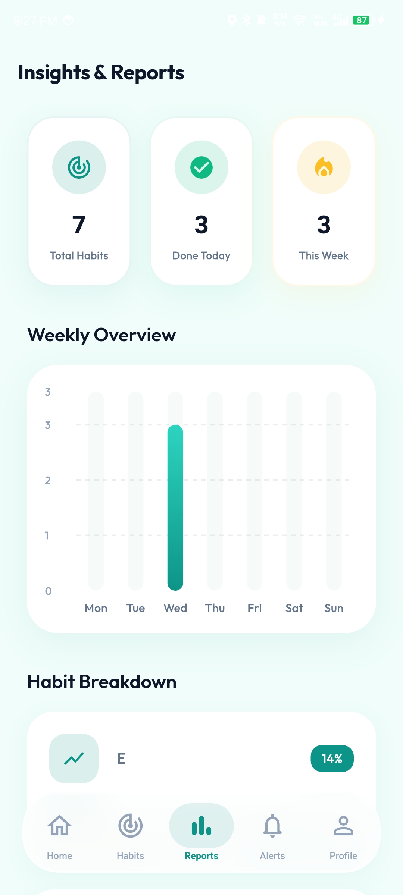
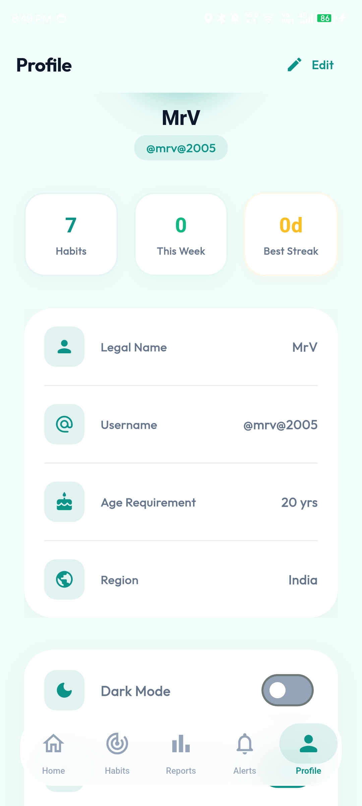
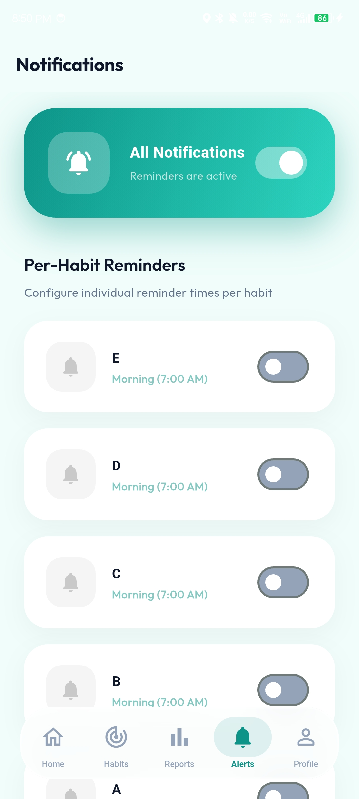

# 🌟 Habit Tracker App

> A modern, intuitive, and feature-rich habit tracking application built with Flutter to help you build better routines and achieve your personal goals.

---

## 📱 App Overview

The **Habit Tracker App** is designed to empower users to build positive habits and maintain consistency in their daily lives. By providing a clean and intuitive interface, the app simplifies the process of tracking daily routines, whether it's drinking water, reading, or exercising.

**Core Objectives:**
- **Productivity & Consistency:** Help users stay accountable to their goals through daily tracking and visual progress indicators.
- **User-Focused Design:** Deliver a seamless and engaging experience with a modern UI, smooth animations, and personalized settings.
- **Habit Tracking Functionality:** Allow users to easily add, manage, and complete habits, turning aspirations into daily actions.

---

## ✨ Features

- 🔐 **User Authentication:** Secure sign-up, login, and profile management.
- 📝 **Habit Management:** Create, edit, personalize, and delete daily habits.
- 📊 **Reports & Analytics:** Visualize progress with weekly reports and completion charts.
- 🔔 **Notifications:** Set custom local reminders for individual habits.
- ⚙️ **Settings:** Customize app preferences, including dark/light mode themes.
- 💾 **Local Storage:** Efficient offline data caching using Hive/SharedPreferences.
- 🌐 **API Integration:** Seamless data fetching and synchronization.
- 🗄️ **Database Integration:** Robust cloud storage and real-time updates via Supabase/Firebase.
- 📱 **Responsive UI:** Adapts beautifully to different screen sizes and orientations.
- 💫 **Smooth Animations:** Engaging micro-interactions and screen transitions.

---

## 🛠️ Tech Stack

- **Frontend:** [Flutter](https://flutter.dev/), [Dart](https://dart.dev/)
- **Backend/Database:** [Supabase](https://supabase.com/) / [Firebase](https://firebase.google.com/)
- **Local Storage:** [Hive](https://pub.dev/packages/hive), [Shared Preferences](https://pub.dev/packages/shared_preferences)
- **State Management:** Provider / Riverpod / Bloc
- **UI & Design:** Material 3, Custom Animations
- **Key Packages:** 
  - `flutter_local_notifications` (Reminders)
  - `fl_chart` (Analytics & Data Visualization)
  - `permission_handler` (OS Permissions)

---

## 📂 Folder Structure

```textcodeed/
├── android/              # Native Android configuration
├── assets/               # Local assets (images, icons, etc.)
├── build/                # Compiled output
├── ios/                  # Native iOS configuration
├── lib/                  # Main Flutter application code
│   ├── animated_widget.dart
│   ├── app_constants.dart
│   ├── app_theme.dart
│   ├── auth_provider.dart
│   ├── google_drive_backup_service.dart
│   ├── habit_completion_model.dart
│   ├── habit_model.dart
│   ├── habit_provider.dart
│   ├── habit_screen.dart
│   ├── hive_storage.dart
│   ├── home_screen.dart
│   ├── main.dart         # App entry point
│   ├── main_shell.dart
│   ├── notification_provider.dart
│   ├── notification_screen.dart
│   ├── notification_service.dart
│   ├── onboarding_screen.dart
│   ├── profile_screen.dart
│   ├── report_screen.dart
│   ├── theme_provider.dart
│   └── user_model.dart
├── test/                 # Automated tests
└── pubspec.yaml          # Project configuration and dependencies
```

---

## 🚀 Installation & Setup

Follow these steps to run the project locally:

1. **Clone the repository:**
   ```bash
   git clone https://github.com/yourusername/habit-tracker-app.git
   cd habit-tracker-app
   ```

2. **Install dependencies:**
   ```bash
   flutter pub get
   ```

3. **Configure Supabase Keys:**
   - Create a `.env` file in the root directory.
   - Add your Supabase URL and Anon Key:
     ```env
     SUPABASE_URL=your_supabase_project_url
     SUPABASE_ANON_KEY=your_supabase_anon_key
     ```

4. **Run SQL Schema (if using Supabase):**
   - Execute the required SQL scripts in your Supabase SQL editor to create the necessary tables.

5. **Run the App:**
   ```bash
   flutter run
   ```

---

## 🗄️ Database Configuration

This project utilizes **Supabase** for robust backend services.

- **Supabase Setup:** Initialize the Supabase client in your Flutter app using the URL and Anon Key.
- **Authentication:** Supabase Auth is used for email/password user registration and login.
- **Required Tables:**
  - `profiles`: Stores user metadata, linked to the Auth UUID.
  - `habits`: Stores habit details (name, color, frequency, created_at) linked to a user.
  - `habit_completions`: Tracks the specific dates a habit was completed to generate statistics and streaks.

---

## 🔌 API Integration

The app is built to communicate efficiently with backend services:
- **External API Usage:** Connects to REST APIs (via Supabase SDK or custom endpoints) for syncing data.
- **Data Fetching:** Implements asynchronous API calls to load user profiles and habit lists.
- **JSON Parsing:** Uses standard Dart conventions (or code generation tools like `json_serializable`) to parse incoming JSON responses into robust model classes.
- **Error Handling:** Gracefully handles network errors, timeouts, and API exceptions, providing meaningful feedback to the user.

---

## 🔔 Notifications

The app supports custom local notifications to keep users engaged.
- **Local Notifications:** Implemented using `flutter_local_notifications`.
- **Scheduling Reminders:** Users can set specific times to be reminded of particular habits.
- **Android Permissions:** Utilizes `permission_handler` to explicitly request `POST_NOTIFICATIONS` and `SCHEDULE_EXACT_ALARM` permissions on newer Android versions.
- **Notification Setup:** Configured in the app initialization phase to handle foreground and background notification taps.

---

## 📱 Screens Included

- 🔐 **Login Screen:** Existing user authentication.
- 📝 **Signup Screen:** New user registration.
- 🏠 **Home Screen:** Dashboard displaying today's habits and weekly overview.
- 🔍 **Detail Screen:** In-depth view of a specific habit's history and streak.
- 👤 **Profile/Favorites Screen:** User information and favorite habits.
- 📈 **Reports Screen:** Charts and graphs visualizing completion data.
- ⚙️ **Settings Screen:** App preferences and theme toggles.
- 🔔 **Notifications Screen:** Manage scheduled reminders.

---

## 📜 User Stories

### Authentication
- **User Registration:** As a user, I want to create an account using my email and password, so that my habit data can be securely saved and synced.
- **User Login:** As a user, I want to log into my existing account, so that I can access my personalized habits and progress.
- **Login Error Feedback:** As a user, I want to see clear error messages if my login fails, so that I know how to correct the issue.

### Homepage
- **View Welcome Message:** As a user, I want to see a personalized welcome message on the home screen, so that the app feels inviting.
- **Display Weekly Progress:** As a user, I want to see a quick summary of my progress for the current week, so that I can easily gauge my consistency.
- **View Completed Habits:** As a user, I want to clearly distinguish between completed and pending habits for today, so that I know what tasks remain.

### Navigation/Menu
- **Access Menu Options:** As a user, I want a clear navigation menu, so that I can easily move between different sections of the app.
- **Navigate to Profile:** As a user, I want to quickly access my profile page, so that I can manage my personal details.
- **Navigate to Habits Page:** As a user, I want to navigate to a dedicated habits page, so that I can view and manage my entire list of routines.
- **Sign Out:** As a user, I want the option to securely sign out of my account, so that my data remains private on shared devices.

### Profile Page
- **View Personal Information:** As a user, I want to see my current profile details, so that I can verify my account information.
- **Edit Personal Information:** As a user, I want to edit my profile details, so that my information stays up to date.
- **Save Updated Information:** As a user, I want my profile changes to be saved securely to the database, so that they persist across sessions.
- **Update Name in Header:** As a user, I want my updated name to immediately reflect in the app header, so that I receive immediate visual confirmation of the change.

### Habits Page
- **Add New Habit:** As a user, I want to add a new habit with a custom name, so that I can start tracking a new goal.
- **Delete Habit:** As a user, I want to be able to delete a habit I no longer wish to track, so that my list remains relevant.
- **Personalize Habit Color:** As a user, I want to assign specific colors to different habits, so that I can visually categorize and identify them easily.

### Reports Page
- **View Weekly Reports:** As a user, I want to view a detailed report of my habit completion over the past week, so that I can analyze my short-term trends.
- **Visualize Completed Habits:** As a user, I want to see my progress represented visually (e.g., through charts), so that the data is easy to understand at a glance.
- **View All Habits:** As a user, I want to see statistics encompassing all my active habits, so that I have a comprehensive view of my overall productivity.

### Notifications
- **Enable/Disable Notifications:** As a user, I want the ability to globally toggle notifications on or off, so that I can control app interruptions.
- **Select Habits for Notifications:** As a user, I want to choose specifically which habits trigger reminders, so that I only receive alerts for the most important tasks.
- **Set Notification Times:** As a user, I want to set a custom time for each habit reminder, so that I am prompted at the most effective moment in my day.

---

## 🎨 UI/UX

- **Modern UI Design:** Clean, uncluttered interfaces focused on usability.
- **Material 3:** Leveraging the latest Material Design guidelines for consistent, modern components.
- **Responsive Layouts:** Ensuring the app looks great on phones, tablets, and varying screen ratios.
- **Smooth Animations:** Utilizing Hero animations, implicit animations, and custom page transitions for a premium feel.
- **Dark/Light Mode:** Full support for system-level or user-defined dynamic themes.
- **Interactive Components:** Tactile feedback and visually responsive buttons and cards.

---

## 📸 Screenshots

| Login / Signup | Home Screen | Habit Details |
|:---:|:---:|:---:|
|  |  |

| Reports & Analytics | Settings | Notifications |
|:---:|:---:|:---:|
|  |  |  |

---

## 🚀 Future Improvements

- ☁️ **Cloud Sync:** Enhanced multi-device synchronization.
- 👥 **Social Features:** Connect with friends, share progress, and compete on leaderboards.
- 🤖 **AI Recommendations:** Smart habit suggestions based on user activity and goals.
- 📈 **Advanced Analytics:** Deeper insights, monthly/yearly trends, and exportable reports.
- ⌚ **Wearable Integration:** Companion apps for Apple Watch and Wear OS devices.

---

## 👨‍💻 Author

**[Your Name / Developer Name]**
- GitHub: [@yourgithubprofile](https://github.com/Dev-MrV/)
- LinkedIn: [MrV](www.linkedin.com/in/mrinal-v)

---

## 📄 License

This project is licensed under the MIT License - see the [LICENSE](LICENSE) file for details.
